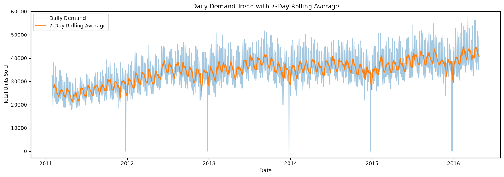
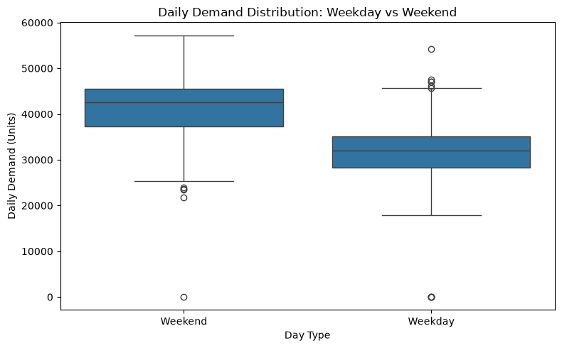
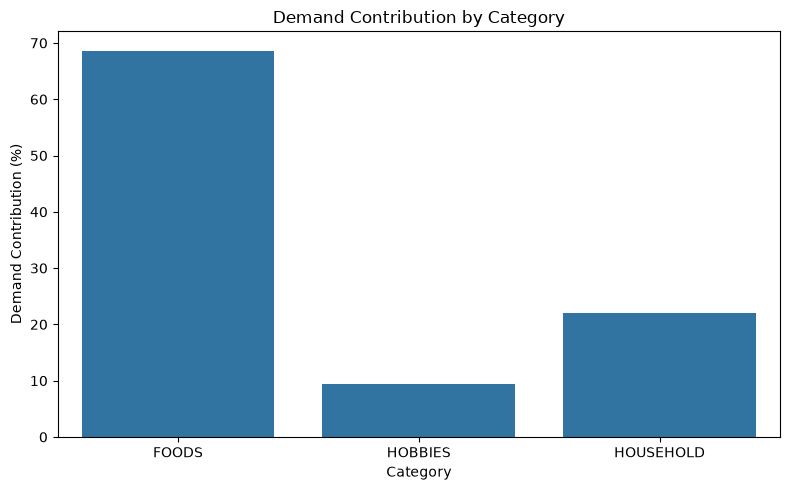
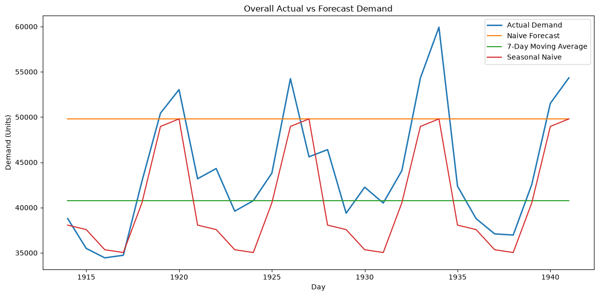
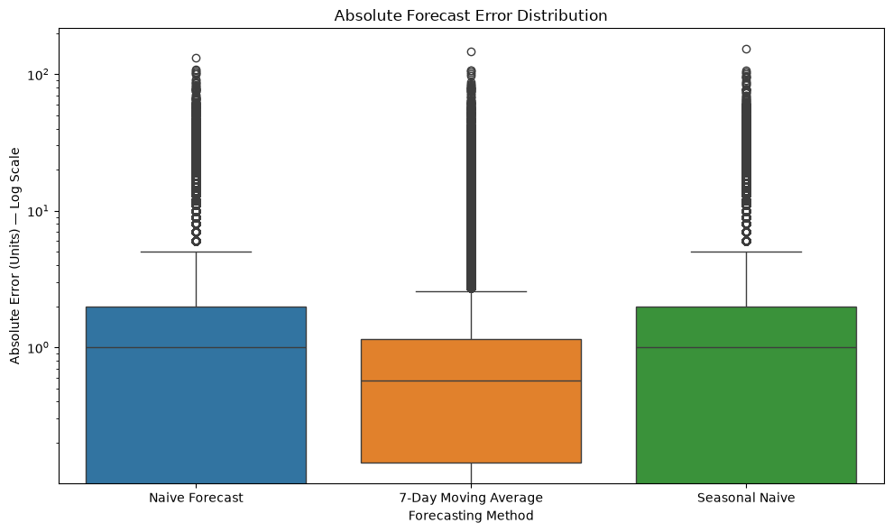

# Retail Demand Forecasting & Forecast Error Analysis

A Python-based retail demand analysis project using the Walmart M5 dataset to analyze historical demand, evaluate short-term forecasting baselines, and examine where forecast errors are higher and which demand patterns are associated with them.

## Objective

Analyze historical retail demand, evaluate practical short-term forecasting baselines, and identify demand patterns associated with higher forecast errors to support better demand planning decisions.

## Business Questions

1. What does retail demand look like and what patterns exist?
2. How accurately can short-term demand be forecast?
3. Where are forecast errors highest, and what demand patterns are associated with those errors?

## Dataset

This project uses the **Walmart M5 Forecasting** dataset from Kaggle.

The dataset contains historical daily sales, calendar information, and selling prices across products and stores.

The original dataset is **not included in this repository**. Please refer to the original Kaggle dataset for the source data.

## Analytical Grain

The analysis is performed at the **Product × Store × Day** level.

Forecasting is performed at the **Product × Store** level over a **28-day forecast horizon**.

## Workflow

1. Data Preparation
2. Demand Analysis
3. Demand Forecasting
4. Forecast Evaluation
5. Forecast Error Analysis
6. Business Interpretation

## Data Preparation

The M5 sales data was prepared for time-series analysis by:

- Checking dataset structure, grain, duplicates, data types, and missing values
- Validating dates and demand-related fields
- Transforming the sales data from wide format into Product × Store × Day records
- Validating the transformed data before analysis

## Demand Analysis

Historical demand was analyzed across:

- Product categories and departments
- Stores and states
- Weekday and weekend patterns
- Monthly and yearly trends
- Demand concentration
- Selling price trends

## Demand Forecasting

Three practical baseline forecasting methods were implemented and compared:

- Naive
- 7-Day Moving Average
- Seasonal Naive

Forecast horizon: **28 days**

Forecast grain: **Product × Store**

## Forecast Evaluation

Forecast performance was evaluated using:

- WAPE (Weighted Absolute Percentage Error)
- MAE (Mean Absolute Error)
- Forecast Bias

Forecast cutoff: **April 24, 2016**

Evaluation period: **April 25, 2016 to May 22, 2016**

Forecast horizon: **28 days**

Among the three tested baselines, the **7-Day Moving Average** achieved the lowest WAPE (**74.04%**) and MAE (**1.07**) in the evaluation period.

## Forecast Error Analysis

Forecast errors were analyzed across:

- Product categories and departments
- Stores and states
- Weekday and weekend demand
- Monthly patterns
- Demand intermittency
- Demand volatility
- SNAP periods

The analysis was used to identify where forecast errors were higher and examine the demand patterns associated with them.

## Key Findings

- Historical demand totaled **65.7M units** across the analysis period.
- Weekend demand averaged **41,338 units**, compared with **31,533 units** on weekdays.
- **FOODS** accounted for **68.6%** of total demand.
- The **7-Day Moving Average** achieved the lowest WAPE (**74.04%**) and MAE (**1.07**) among the three tested baselines.
- **FOODS** had the highest proportion of its Product × Store series classified as High-Error, at **47.43%**, among the three product categories.

## Business Recommendations

The following recommendations translate the forecast-error findings into practical actions for demand planning.

- **Focus on products and stores with repeated forecast errors:** Regularly review products and stores where forecasts repeatedly differ significantly from actual sales.

- **Give more attention to hard-to-predict products:** Give closer attention to products with irregular sales patterns and review their forecasts more frequently.

- **Consider both units and percentage differences:** Consider both the number of units missed and the percentage difference when deciding which products need attention.

- **Consider calendar patterns:** Pay closer attention to forecasts around recurring calendar periods where larger differences were observed.

- **Use the recent 7-day average as a practical baseline:** Use the recent 7-day sales average as a practical starting point for short-term demand planning and monitor where it performs poorly.

- **Investigate persistent forecast problems:** When forecasting problems persist, investigate factors such as promotions, product availability, assortment changes, and other business events before changing the forecasting approach.

## Key Visualizations

### Historical Demand

### Weekday vs Weekend Demand

### Demand by Product Category

### Forecast Comparison

### Forecast Error Analysis

## Tools & Technologies

- Python
- Pandas
- NumPy
- Matplotlib
- Seaborn
- Jupyter Notebook

## Notebooks

| Notebook | Description |
|---|---|
| `01_data_preparation.ipynb` | Data structure, quality checks, transformation, and validation |
| `02_demand_analysis.ipynb` | Historical retail demand analysis and demand patterns |
| `03_demand_forecasting.ipynb` | Baseline forecasting methods and forecast evaluation |
| `04_forecast_error_analysis.ipynb` | Forecast error analysis and associated demand patterns |

## Case Study

A detailed case study covering the analysis, forecasting results, forecast error analysis, and business interpretation is available here:

[View the Retail Demand Forecasting Case Study](reports/Retail_Demand_Forecasting_&_Forecast_Error_Analysis_Case_Study.pdf)

## Limitations

- The analysis uses baseline forecasting methods rather than machine learning models.
- Forecast performance is evaluated on a single 28-day horizon.
- The original M5 dataset is not included in this repository.

## Usage

© 2026 Sai Alekya Vangaveti. All rights reserved.

This repository is provided for viewing and educational/recruitment purposes.
The project, documentation, and original code may not be copied, modified,
redistributed, or presented as another person's work without permission.